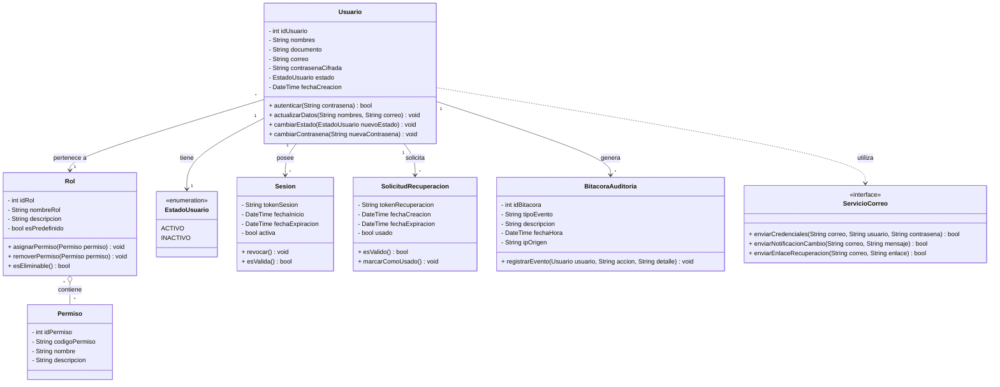
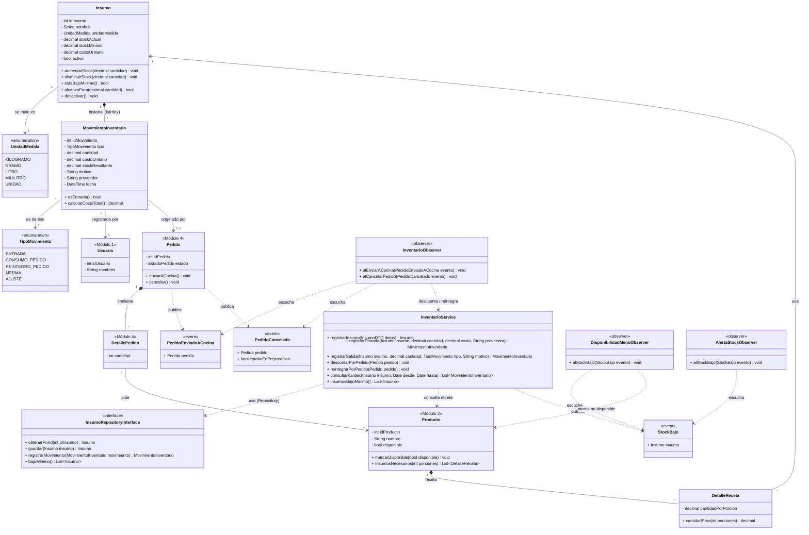

# Diagrama de Clases UML - SIAR

## Módulo 1: Gestión de Usuarios

---

## Módulo 5: Inventario

Requerimientos: RF23 a RF27 y RF38 a RF40 (ver [Proyecto_de_semestre.md](Proyecto_de_semestre.md)).

Las clases `Producto`, `Pedido`, `DetallePedido` y `Usuario` pertenecen a los módulos 2, 4 y 1. Aquí solo aparecen los atributos y métodos que usa el inventario.

### Cómo se conecta el inventario con los otros módulos

| Requerimiento | Clases involucradas | Qué pasa |
|---|---|---|
| RF23, RF24 | `Insumo`, `InventarioService` | Se crean, modifican y desactivan insumos. Un insumo con historial se desactiva en vez de borrarse. |
| RF25, RF26 | `MovimientoInventario`, `TipoMovimiento` | Cada entrada, merma o ajuste queda como un movimiento con su usuario, motivo y stock resultante. |
| RF27 | `InventarioService.consultarKardex()` | El kárdex es la lista de movimientos de un insumo en un rango de fechas. |
| RF38 | `Producto`, `DetalleReceta`, `Insumo` | La receta dice cuánto de cada insumo lleva una porción del producto. |
| RF39 | `PedidoEnviadoACocina`, `PedidoCancelado`, `InventarioObserver` | Al enviar un pedido a cocina se descuentan los insumos (`CONSUMO_PEDIDO`). Si se cancela antes de prepararse, se reintegran (`REINTEGRO_PEDIDO`); si ya estaba en preparación, se registra como `MERMA`. |
| RF40 | `StockBajo`, `DisponibilidadMenuObserver`, `AlertaStockObserver` | Cuando un insumo baja del mínimo se avisa al administrador, y los productos que ya no se pueden preparar se marcan como no disponibles (RF11). |
| RF35 | `MovimientoInventario` | El reporte de consumo de inventario se calcula a partir de los movimientos de tipo `CONSUMO_PEDIDO` y `MERMA`. |

### Patrones aplicados en este módulo

- **Observer:** `Pedido` publica `PedidoEnviadoACocina` y `PedidoCancelado`, y el inventario reacciona sin que el módulo de Pedidos lo conozca. Igual con `StockBajo`, que lo escuchan la alerta y la disponibilidad del menú.
- **Repository:** `InventarioService` trabaja con `InsumoRepositoryInterface`, no con la base de datos directamente.
- **DTO:** los datos de entrada (por ejemplo `InsumoDTO`) llegan validados al servicio, igual que en el Módulo 1.
