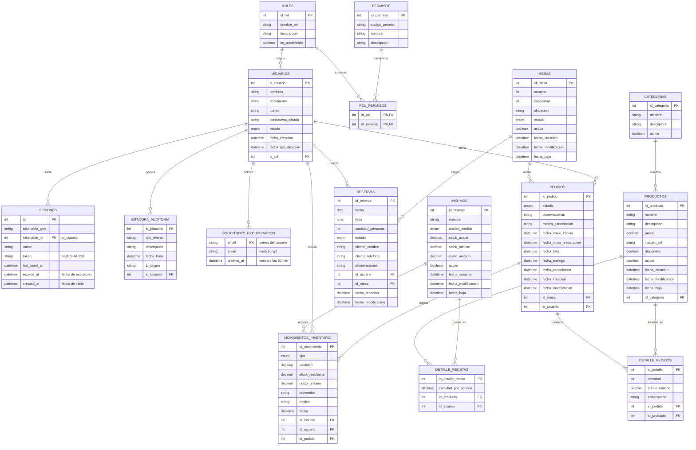

# Sistema Integral de Administración para Restaurantes (SIAR)

## Modelo Entidad-Relación (DER) - Módulos 1, 2 y 3

## Notas de implementación (Módulo 1)

- Las migraciones están en `backend/database/migrations` y usan los mismos nombres de tablas y columnas de este modelo.
- **SESIONES**: cada fila es un token de Laravel Sanctum (modelo `App\Models\Sesion`). Una sesión está activa mientras su fila exista y `expires_at` no haya pasado (8 horas por defecto). Revocar una sesión es borrar la fila, por eso no se necesita la columna `activa`.
- **SOLICITUDES_RECUPERACION**: la usa el sistema de recuperación de contraseñas de Laravel. El token se guarda cifrado, vence a los 60 minutos y se borra al usarse, así que es de un solo uso (reemplaza a la columna `usado`).
- **BITACORA_AUDITORIA**: si un usuario se borra físicamente, sus registros se conservan con `id_usuario` en `NULL`.
- **USUARIOS.estado**: `activo` o `inactivo`. La eliminación lógica (CU-03) pone el estado en `inactivo`.

## Notas de implementación (Módulo 2)

- **CATEGORIAS.nombre** es único (sin distinguir mayúsculas). Una categoría con productos, incluso dados de baja, no se borra: se pone `activa = false` y deja de mostrarse en la carta.
- **PRODUCTOS.nombre** no es único: el CU01 permite repetirlo en una categoría si el administrador lo confirma.
- **PRODUCTOS.precio** es `decimal(12,2)` y no puede ser negativo. Los pedidos (Módulo 4) deben guardar su propio precio unitario, para que un cambio de precio no sea retroactivo (CU02).
- **PRODUCTOS.imagen_url** guarda la ruta relativa de la imagen (por ejemplo `productos/abc.jpg`) dentro de `backend/public/imagenes`. La API devuelve la URL completa.
- **PRODUCTOS.activo / fecha_baja**: baja lógica del CU03 (trait `TieneBajaLogica`). El producto sale de la carta, pero se conserva para el historial y RF34.
- **PRODUCTOS.disponible**: CU05, lo cambia el Cocinero con el permiso `gestionar_disponibilidad`, que agrega la migración `2026_11_04_000003`.
- **PRODUCTOS.fecha_creacion / fecha_modificacion** las llena Laravel automáticamente.

## Notas de implementación (Módulo 3)

- **MESAS.numero** es único. **MESAS.estado** es `libre`, `ocupada`, `reservada` o `mantenimiento`, y solo cambia por las transiciones del patrón State (`app/Estados/Mesa`).
- **MESAS.ubicacion** (salón, terraza...) y **activo / fecha_baja** (baja lógica) se agregaron al modelo original. Una mesa con historial de reservas no se borra físicamente.
- **RESERVAS.id_usuario** es el usuario del personal que registró la reserva. Los datos del cliente van en **cliente_nombre** y **cliente_telefono**, porque el sistema no tiene un rol "Cliente" (una reserva pública hecha por el cliente sería parte del módulo Reservas del tercer corte).
- **RESERVAS.estado** es `pendiente`, `cumplida` (llegó el cliente), `cancelada` o `no_asistio` (pasó la tolerancia sin llegar).
- **RESERVAS.fecha / hora** están en la zona horaria del restaurante (`America/Bogota`, en `config/siar.php`). Duración de la reserva: 2 h; la mesa pasa a `reservada` 1 h antes; tolerancia: 20 min. Todo es configurable con variables `SIAR_RESERVA_*` del `.env`.

## Notas de implementación (Módulo 4)

- **PEDIDOS.estado**: `pendiente`, `en_preparacion`, `listo`, `entregado`, `facturado` o `cancelado`. Las transiciones permitidas están en `App\Enums\EstadoPedido`.
- "Pendiente" tiene dos momentos: mientras el mesero lo arma (`fecha_envio_cocina` vacía) y cuando ya está en la cola de cocina. Al enviarlo a cocina ya no se puede modificar, porque el inventario descontará los insumos en ese momento (RF39).
- **PEDIDOS.id_usuario** es el mesero que tomó el pedido. Cada paso guarda su fecha (envío, preparación, listo, entrega, cancelación) para el seguimiento y los reportes.
- **DETALLE_PEDIDOS.precio_unitario** es una copia del precio del producto al pedirlo: si el precio del menú cambia, los pedidos existentes no cambian (CU02 del Módulo 2). El total del pedido es la suma de `cantidad × precio_unitario`.
- Un producto con líneas en pedidos `pendiente` o `en_preparacion` no se puede dar de baja (CU03 del Módulo 2), y una mesa con pedidos sin facturar no se puede liberar (RF16 del Módulo 3).

## Notas de implementación (Módulo 5)

- **INSUMOS.nombre** es único. **unidad_medida**: `kilogramo`, `gramo`, `litro`, `mililitro` o `unidad`; no se puede cambiar si el insumo ya tiene movimientos o recetas.
- **INSUMOS.stock_actual** no se edita directamente: solo cambia con movimientos. El stock inicial al registrar el insumo queda como un `ajuste` con motivo "Stock inicial".
- **MOVIMIENTOS_INVENTARIO.cantidad** lleva signo: positiva si entra (entrada, reintegro, ajuste a favor) y negativa si sale (consumo, merma, ajuste en contra). **stock_resultante** es el saldo después del movimiento (columna "Saldo" del kárdex). **tipo**: `entrada`, `consumo_pedido`, `reintegro_pedido`, `merma` o `ajuste`.
- **MOVIMIENTOS_INVENTARIO.id_pedido** se llena en consumos, reintegros y mermas que vienen de un pedido (RF39). **id_usuario** es quien hizo la acción (para los consumos, el mesero que envió el pedido).
- **DETALLE_RECETAS**: un insumo aparece una sola vez por producto. **cantidad_por_porcion** está en la unidad del insumo.
- **PRODUCTOS.agotado_por_inventario** (columna nueva): `true` cuando el inventario dejó el producto no disponible (RF40). Al reponer el insumo solo se reactivan esos productos; si el cocinero lo marcó agotado a mano (CU05), la columna queda en `false` y la reposición no lo toca.
- El consumo por pedidos puede dejar el stock en negativo: indica que el inventario físico no coincide y hay que hacer un ajuste por conteo.
