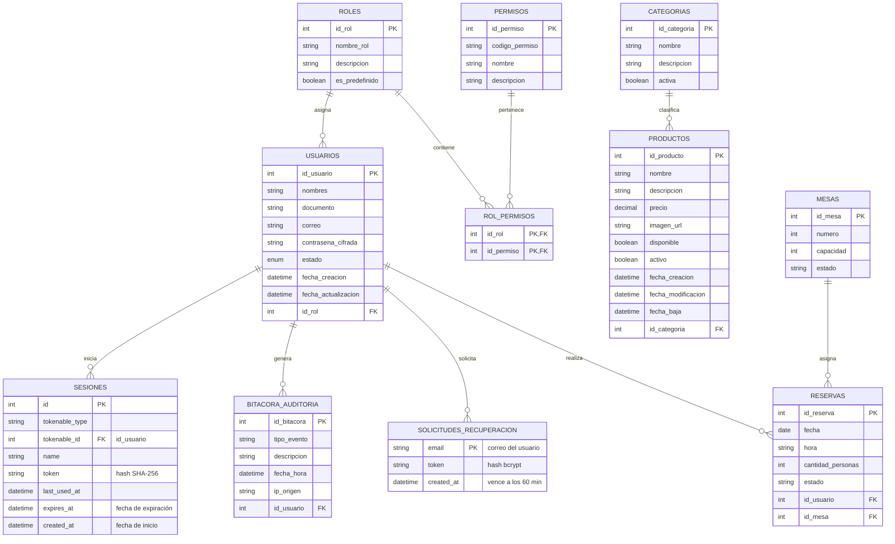

# Sistema Integral de Administración para Restaurantes (SIAR)

## Modelo Entidad-Relación (DER) - Módulos 1, 2 y 3

## Notas de implementación (Módulo 1)

- Las migraciones están en `backend/database/migrations` y usan los mismos nombres de tablas y columnas de este modelo.
- **SESIONES**: cada fila es un token de Laravel Sanctum (modelo `App\Models\Sesion`). Una sesión está activa mientras su fila exista y `expires_at` no haya pasado (8 horas por defecto). Revocar una sesión es borrar la fila, por eso no se necesita la columna `activa`.
- **SOLICITUDES_RECUPERACION**: la usa el sistema de recuperación de contraseñas de Laravel. El token se guarda cifrado, vence a los 60 minutos y se borra al usarse, así que es de un solo uso (reemplaza a la columna `usado`).
- **BITACORA_AUDITORIA**: si un usuario se borra físicamente, sus registros se conservan con `id_usuario` en `NULL`.
- **USUARIOS.estado**: `activo` o `inactivo`. La eliminación lógica (CU-03) pone el estado en `inactivo`.
